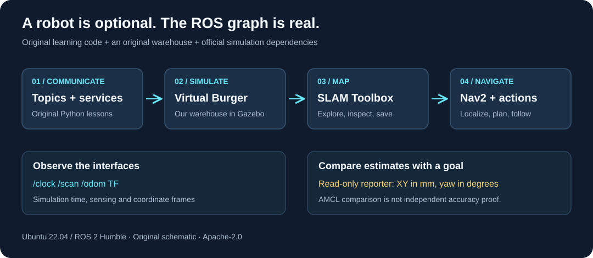
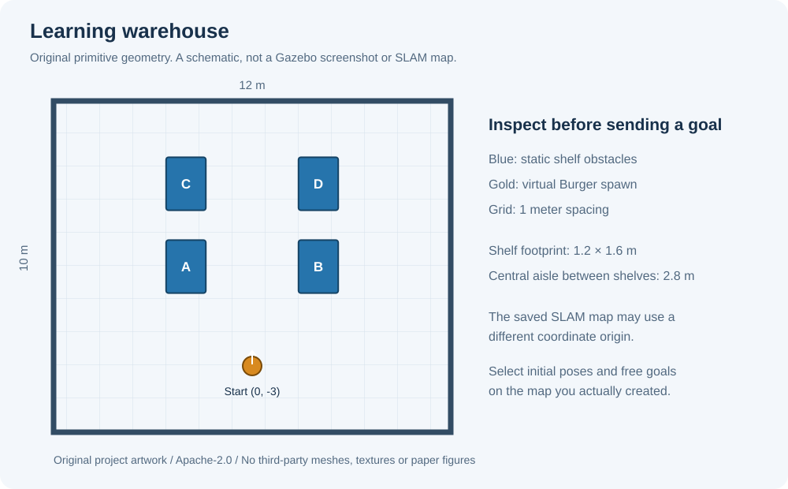

# ROS without robots

[](https://github.com/Hareespandy-N/ROS-without-robots/actions/workflows/ci.yml)

Learn ROS 2 communication, build a map, and explore AMR navigation using a virtual robot. Designed for **Ubuntu 22.04 + ROS 2 Humble**.

[தமிழ் வழிகாட்டி](docs/README.ta.md) · [Step-by-step lessons](docs/lessons.md) · [Papers and sources](docs/references.md) · [What is tested](docs/validation.md)



This repository contains original lesson nodes, a read-only localization error reporter, a warehouse world built from simple geometry, launch files, and explanations. It uses the official TurtleBot3 Burger, Gazebo, SLAM Toolbox and Nav2 as separately installed dependencies. Their implementations and robot assets remain upstream.

## Start here

Use a development PC running Ubuntu 22.04. Install ROS 2 Humble using the [official Ubuntu instructions](https://docs.ros.org/en/humble/Installation/Ubuntu-Install-Debs.html) first. This project uses the Humble **Gazebo Classic** ecosystem; commands for other ROS distributions or modern Gazebo are different.

Install the learning and simulation dependencies:

```bash
sudo apt update
sudo apt install python3-colcon-common-extensions \
  ros-humble-turtlesim ros-humble-turtlebot3-gazebo \
  ros-humble-turtlebot3-teleop ros-humble-turtlebot3-navigation2 \
  ros-humble-slam-toolbox ros-humble-nav2-bringup

mkdir -p ~/robotless_ws/src
git clone https://github.com/Hareespandy-N/ROS-without-robots.git \
  ~/robotless_ws/src/ROS-without-robots
cd ~/robotless_ws
source /opt/ros/humble/setup.bash
colcon build --symlink-install
```

Run this environment block in **every new terminal** used for the lessons:

```bash
source /opt/ros/humble/setup.bash
source ~/robotless_ws/install/setup.bash
export ROS_DOMAIN_ID=42
export ROS_LOCALHOST_ONLY=1
export TURTLEBOT3_MODEL=burger
```

These are local simulation conventions. Keep this learning session separate from equipment networks; a domain number is not a safety barrier.

Try the original publisher/subscriber lesson:

```bash
ros2 launch robotless_lab lesson.launch.py
```

Or open the original warehouse with the installed virtual Burger:

```bash
ros2 launch robotless_lab simulation.launch.py
# Without a graphical client:
# ros2 launch robotless_lab simulation.launch.py gui:=false
```



The drawing is a schematic, not a screenshot or a SLAM map. The virtual robot starts at world `(0, -3)` meters. It receives no movement goal at startup.

## Learning path

| Stage | Learn | Start |
| --- | --- | --- |
| 1 | Nodes, topics and messages | `ros2 launch robotless_lab lesson.launch.py` |
| 2 | Services and parameters | `ros2 run turtlesim turtlesim_node` |
| 3 | Simulated LiDAR, odometry and TF | `ros2 launch robotless_lab simulation.launch.py` |
| 4 | SLAM and saving a map | `ros2 launch robotless_lab mapping.launch.py` after stage 3 |
| 5 | Localization, actions and Nav2 | `ros2 launch robotless_lab navigation.launch.py map:=/absolute/path/map.yaml` |
| 6 | Goal-versus-AMCL error in mm | `ros2 run robotless_lab pose_report` with your goal parameters |

Follow [the complete lessons](docs/lessons.md), including map saving and setting an initial pose, before sending navigation goals. Mapping and navigation are separate modes; stop mapping before starting saved-map navigation.

## Development checks

From this repository's root, with Python 3.10 or newer:

```bash
PYTHONPATH=src/robotless_lab python3 -m unittest discover -s tests -p 'test_*.py' -v
python3 -m compileall -q src tests tools
python3 tools/check_project.py
```

GitHub Actions also builds the actual Humble package, exercises ROS communication and the reporter, checks launch resources, and starts headless Gazebo to inspect `/clock`, `/scan` and `/odom`. See the [workflow](.github/workflows/ci.yml), its run logs and [validation boundaries](docs/validation.md). A passed sensor smoke check does not prove a completed SLAM or navigation mission.

## Papers, reuse and license

The ROS 2 architecture paper and *The Marathon 2* are reading references, with original study notes in [references](docs/references.md). This is an independent educational project, not an implementation of a new research algorithm or an official ROS/ROBOTIS distribution.

Original repository code, text, diagrams and warehouse geometry are licensed under [Apache-2.0](LICENSE). See [NOTICE](NOTICE) and [third-party notices](THIRD_PARTY_NOTICES.md) for dependency and paper provenance. No third-party paper figures, screenshots, meshes or PDFs are included.

The pose reporter compares a goal with a localization estimate. **Physical accuracy within +/-1 mm is not proven yet.** Independent calibrated metrology and repeated physical trials would be needed for that claim.
