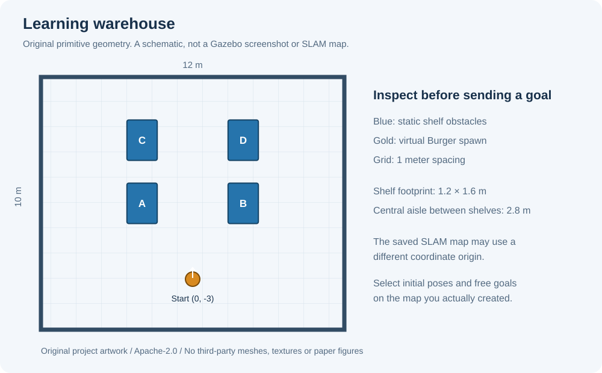

# Robot இல்லாமல் ROS 2 கற்போம்

[English README](../README.md) · [முழு lessons](lessons.md) · [Papers / sources](references.md)

இந்த project **Ubuntu 22.04 + ROS 2 Humble** development PC-க்கானது. Nodes, topics, services கற்றுக்கொண்டு, Gazebo-வில் virtual AMR ஓட்டி, SLAM map உருவாக்கி, Nav2 navigation பயிற்சி செய்யலாம்.

நம்ம repository-ல் சொந்த Python examples, warehouse world, launch files, diagrams, விளக்கங்கள் உள்ளன. Robot model, SLAM, navigation ஆகியவற்றுக்கு official packages பயன்படுத்தப்படுகின்றன.

## முதல் setup

முதலில் [official ROS 2 Humble installation](https://docs.ros.org/en/humble/Installation/Ubuntu-Install-Debs.html) முடித்திருக்க வேண்டும். கீழே உள்ள commands development PC-க்கானவை.

```bash
sudo apt update
sudo apt install python3-colcon-common-extensions \
  ros-humble-turtlesim ros-humble-turtlebot3-gazebo \
  ros-humble-turtlebot3-teleop ros-humble-turtlebot3-navigation2 \
  ros-humble-slam-toolbox ros-humble-nav2-bringup

mkdir -p ~/robotless_ws/src
git clone https://github.com/Hareespandy-N/ROS-without-robots.git \
  ~/robotless_ws/src/ROS-without-robots
cd ~/robotless_ws
source /opt/ros/humble/setup.bash
colcon build --symlink-install
```

ஒவ்வொரு புதிய terminal-லும்:

```bash
source /opt/ros/humble/setup.bash
source ~/robotless_ws/install/setup.bash
export ROS_DOMAIN_ID=42
export ROS_LOCALHOST_ONLY=1
export TURTLEBOT3_MODEL=burger
```

இது local simulation setup. Domain number மட்டும் physical robot-இலிருந்து பாதுகாப்பான பிரிப்பு என்பதை உறுதி செய்யாது.

## படிப்படியாக

1. `ros2 launch robotless_lab lesson.launch.py` — இரண்டு nodes ஒரு topic வழியாக பேசுவதைக் காணலாம்.
2. `ros2 run turtlesim turtlesim_node` — services, parameters கற்கலாம்.
3. `ros2 launch robotless_lab simulation.launch.py` — நம்ம warehouse-ல் virtual Burger உருவாகும்; startup-ல் goal அனுப்பப்படாது.
4. Simulation ஓடும்போது மற்றொரு terminal-ல் `ros2 launch robotless_lab mapping.launch.py` — SLAM தொடங்கும். Teleop செய்து map save செய்ய [lessons](lessons.md#4-build-and-save-a-map) பார்க்கவும்.
5. Mapping-ஐ நிறுத்திவிட்டு `ros2 launch robotless_lab navigation.launch.py map:=/absolute/path/map.yaml` — saved map-ல் navigation. RViz-ல் initial pose சரியாக அமைத்த பிறகே goal கொடுக்கவும்.
6. `pose_report` மூலம் goal மற்றும் AMCL estimate இடையே XY error-ஐ mm-ல் ஒப்பிடலாம். Goal parameters மற்றும் விளக்கம் [இங்கே](lessons.md#6-understand-position-error).



## Copyright மற்றும் accuracy

இந்த repo-வின் சொந்த code, text, diagrams, warehouse geometry-க்கு [Apache-2.0](../LICENSE). Upstream dependencies-ன் licenses தனித்தனியாகவே தொடரும். Papers-ன் PDF, figures அல்லது வேறொருவரின் screenshots copy செய்யப்படவில்லை; citation links சேர்க்கப்பட்டுள்ளன. [Provenance / notices](../THIRD_PARTY_NOTICES.md) பார்க்கவும்.

Simulation result-ஐ physical accuracy என்று சொல்ல முடியாது. **Physical +/-1 mm accuracy: not proven yet.** AMCL/odom independent measurement அல்ல. என்ன check செய்யப்படுகிறது, என்ன இன்னும் test செய்யப்படவில்லை என்பதை [validation](validation.md) தெளிவாகப் பிரிக்கிறது.
